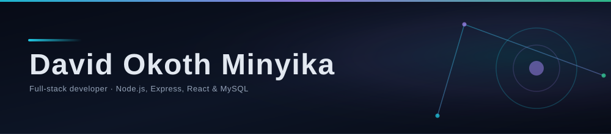
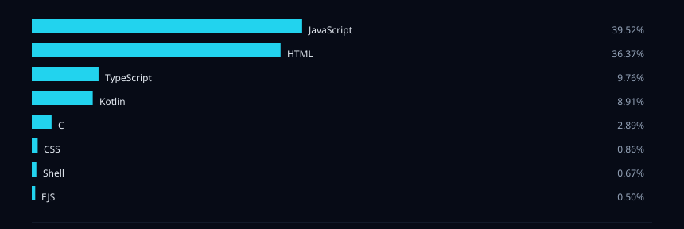
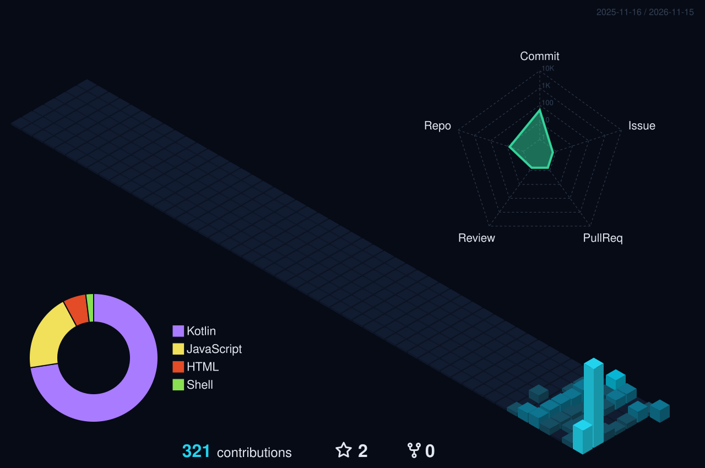

# David Okoth Minyka

Full-stack developer · Node.js, Express, React &amp; MySQL

Kisumu, Kenya

My name is David Okoth Minyka and today is Monday, 16 November 2026 at 08:12:16 GMT+3.

## About

- I am a full-stack developer building web applications with Node.js, Express, React, and MySQL.
- I learn by shipping working software: authentication flows, reservation systems, and API-driven projects.
- Ask me about team leadership, web frameworks, and DevOps. I am open to collaborating on Node.js and backend projects.

## Tech stack

**Backend**

- Node.js, Express, MySQL

**Frontend**

- React, JavaScript, HTML

**Languages &amp; tooling**

- Kotlin, Shell, Git, GitHub Actions, VS Code

## Currently working on

- Full-stack web applications with Node.js, Express, React, and MySQL
- Learning by shipping working software: authentication flows, reservation systems, and API-driven projects
- Learning: Node.js

## Languages

- JavaScript: 39.52%
- HTML: 36.37%
- TypeScript: 9.76%
- Kotlin: 8.91%
- C: 2.89%
- CSS: 0.86%
- Shell: 0.67%
- EJS: 0.5%
- Python: 0.42%
- Makefile: 0.09%
- Mustache: 0.01%
- Lua: 0%

## Statistics

- Stars: 5
- Forks: 0
- Contributions: 323

## Featured repositories

- [davidokothminyika-commits/hotelsystem](https://github.com/davidokothminyika-commits/hotelsystem) — 1 stars and 0 forks
- [davidokothminyika-commits/nodeprs2](https://github.com/davidokothminyika-commits/nodeprs2) — 1 stars and 0 forks
- [davidokothminyika-commits/vscodeconfig](https://github.com/davidokothminyika-commits/vscodeconfig) — 0 stars and 0 forks
- [davidokothminyika-commits/48lawsofpower](https://github.com/davidokothminyika-commits/48lawsofpower) — 0 stars and 0 forks

## Contribution graph

Alternative themes: [night](assets/3d/profile-3d-contrib-night.svg) · [purple](assets/3d/profile-3d-contrib-purple.svg)

## Recent activity

- PushEvent on davidokothminyika-commits&#x2F;davidokothminyika-commits at 2026-11-15T19:14:19.000Z
- PushEvent on davidokothminyika-commits&#x2F;davidokothminyika-commits at 2026-10-20T12:31:37.000Z
- PushEvent on davidokothminyika-commits&#x2F;48lawsofpower at 2026-10-20T12:25:39.000Z
- PushEvent on davidokothminyika-commits&#x2F;hotelsystem at 2026-10-19T15:30:50.000Z
- PushEvent on davidokothminyika-commits&#x2F;48lawsofpower at 2026-10-17T14:08:01.000Z

## Connect

- 🐙 [GitHub](https://github.com/davidokothminyika-commits)
- 📧 [Email](mailto:davidokothminyika@gmail.com)

---

Open to collaborating on Node.js and backend projects.

*Generated automatically from my GitHub activity by the automated profile pipeline.*

*Last updated: Monday, 16 November 2026 at 08:12:16 GMT+3*
